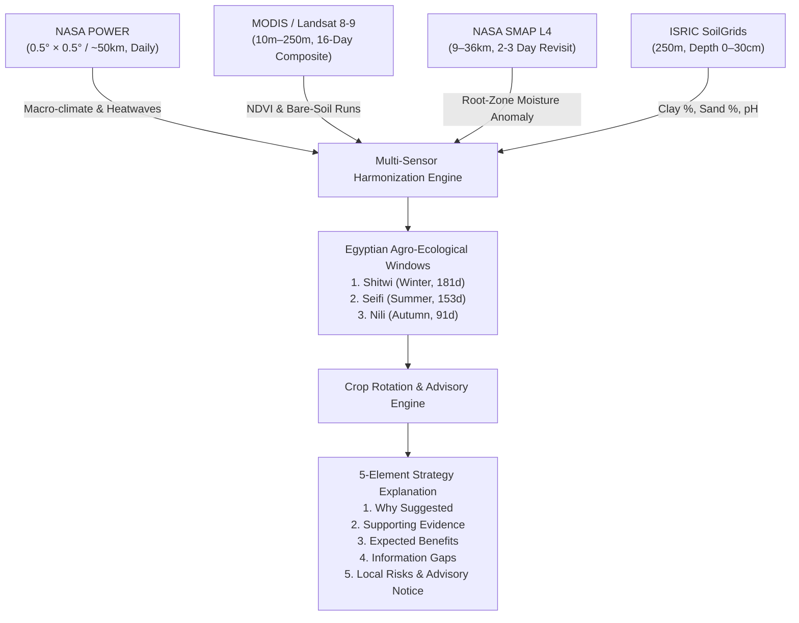

# FieldShift — Core Logic (No UI)

All engine, data, and API layers. No React, no CSS, no components.
Connect your own frontend to these modules.

---

## Folder Structure

```
src/
├── engine/
│   ├── fieldIndices.js       ← Main pipeline: takes inputs+apiData → diagnostics object
│   ├── rotationEngine.js     ← Takes diagnostics → ranked rotation strategies
│   ├── cropEvidence.js       ← Crop heat/water/salinity tolerance lookup
│   ├── referenceEt.js        ← FAO-56 ET₀ calculation helpers
│   └── strategyExplanations.js ← Human-readable labels for each strategy
│
├── services/
│   └── nasaDataService.js    ← Fetches NASA POWER, MODIS NDVI, SoilGrids APIs
│
├── presentation/
│   └── farmerModel.js        ← Post-processes strategies into display-ready objects
│
├── data/
│   ├── egyptCrops.json       ← Crop catalog (names, seasons, water needs)
│   ├── cropEvidence.json     ← Per-crop satellite evidence thresholds
│   ├── demoPresets.json      ← Preset field locations (Giza, Fayoum, etc.)
│   ├── ndviHistory.json      ← 2020–2024 historical NDVI by location
│   ├── observedBenchmarks.json ← Observed ET₀ / climate benchmarks
│   ├── referenceEtDrivers.json ← Monthly ET₀ driver values
│   └── syntheticFixtures.json  ← Test/fallback data when APIs fail
│
└── i18n.js                   ← Simple EN/AR text helper: text(lang, "en", "ar")
```

---

## How to Use

### 1. Fetch data from APIs
```js
import { fetchFieldData } from './src/services/nasaDataService.js'

const data = await fetchFieldData({ lat: 29.9, lon: 31.2 })
// returns: { climate, ndvi, soil, sources }
```

### 2. Compute diagnostics
```js
import { computeFieldIndices } from './src/engine/fieldIndices.js'

const inputs = {
  lat: 29.9,
  lon: 31.2,
  salinityLevel: 'moderate',   // 'low' | 'moderate' | 'high'
  soilTexture: 'clay_loam',
  feddans: 5,
  seasonStartDate: '2025-10-01'  // optional
}

const diagnostics = computeFieldIndices(inputs, data)
// returns: { heatStressDays, bareSoilDays, canopyAnomaly, salinityRisk, ... }
```

### 3. Get rotation strategies
```js
import { rankRotations } from './src/engine/rotationEngine.js'

const evaluation = rankRotations(inputs, diagnostics, data)
// returns: { strategies: [...], diagnostics }
// each strategy: { id, score, crops: [...], waterM3PerFeddan, ... }
```

### 4. Format for display
```js
import { buildFarmerModel } from './src/presentation/farmerModel.js'

const model = buildFarmerModel(evaluation, inputs, data, lang)
// returns display-ready objects with labels, colors, translated text
```

---

## Diagnostics Object (key fields)

| Field | Description |
|-------|-------------|
| `heatStressDays` | Days with Tmax > 38°C (May–Sep) from NASA POWER |
| `bareSoilDays` | Longest autumn NDVI < 0.22 window (bare soil gap) |
| `canopyAnomaly` | Z-score of 2025 peak NDVI vs 2020–2024 baseline |
| `salinityRisk` | 0–100 index (soil + water source) |
| `autumnObservedDays` | MODIS observations available in autumn |
| `rootZoneWetnessAvg` | NASA POWER GWETROOT average |
| `nitrogen` | Derived from SoilGrids SOC |
| `soilOrganicCarbon` | SoilGrids SOC (g/kg) |

---

## Data Sources

| Source | Resolution | What it provides |
|--------|-----------|-----------------|
| NASA POWER | ~50 km daily | Tmax, ET₀, precipitation, solar radiation, humidity |
| MODIS MOD13Q1 / Landsat 8-9 | 250 m / 30 m (16-day) | NDVI greenness time series, bare-soil gaps, canopy anomaly |
| NASA SMAP (L4) | 9 km – 36 km (2–3 day) | Root-zone (0–100 cm) and surface soil moisture saturation |
| ISRIC SoilGrids 2.0 | 250 m static grid | pH, clay %, sand %, SOC, soil nitrogen |

---

## NASA Space Apps Challenge — Data Harmonization & Multi-Sensor Fusion

In accordance with the **NASA Space Apps Challenge: Modeling, SI, and Data Fusion** guidelines, Sky Space (FieldShift) bridges heterogeneous Earth Observation (EO) streams into a unified agro-ecological decision engine:



### 1. Spatial Harmonization & Downscaling
- **Macro-scale Drivers (~50 km)**: Temperature ($T_{\max}, T_{\min}$) and solar radiation from NASA POWER provide regional atmospheric energy demand.
- **Micro-scale Parcel Boundaries (10 m – 30 m)**: Farm polygons drawn on the interactive map capture exact field coordinates. Bilinear interpolation samples macro-weather at the parcel centroid, while MODIS/Landsat composites evaluate the local vegetative canopy (NDVI), masking desert-fringe non-agricultural pixels.

### 2. Temporal Harmonization across Egyptian Agricultural Seasons
Daily continuous satellite observations are harmonized into Egyptian crop windows:
- **العروة الشتوية (Shitwi)**: Nov 1 – Apr 30 (181 days) — Wheat, Egyptian Berseem Clover, Sugar Beet.
- **العروة الصيفية (Seifi)**: May 1 – Sep 30 (153 days) — Maize, Rice, Cotton, Sorghum, Soybeans.
- **العروة النيلية (Nili / Autumn Gap)**: Sep 1 – Nov 30 (91 days) — Short-duration transition crops (Cowpea, Fahl Berseem, Nili Corn).

### 3. Satellite Observations vs. Ground-Truth (In-Situ Reality)
- **What Satellites Provide**: Synoptic coverage, multi-year historical anomaly tracking, regional heat stress counts (>38°C), and bare-soil exposure windows.
- **What Satellites Cannot See (Ground-Truth Requirement)**:
  - Subsurface root-zone soil salinity ($EC_e$ in dS/m) at 30–90 cm depth.
  - Hyper-local nematode or fungal root-rot pathogens.
  - Daily farmgate crop market prices in specific local markaz/governorate markets.
  - Micro-topographical ditch siltation or tail-end canal turn rotation delays.
- **Advisory Mandate**: Sky Space is a **decision-support tool** to empower farmers and extension officers, never a substitute for hands-on agronomic expertise or laboratory soil analyses.

---

---

## Notes for Frontend Dev

- `i18n.js` exports `text(lang, enStr, arStr)` — use lang = `"en"` or `"ar"`
- All money/area in **feddans** (1 feddan = 4200 m²)
- Water volumes in **m³/feddan/season**
- APIs can fail (SoilGrids timeout is common) — `syntheticFixtures.json` is the fallback
- `demoPresets.json` has 4 preset field locations with pre-filled inputs

---

## Full-Stack Architecture (Next.js + Node Express + MongoDB)

FieldShift now includes a full-stack implementation with authentication and MongoDB persistence:

```
FieldShift-core/
├── backend/                  ← Node.js + Express API
│   ├── models/
│   │   ├── User.js           ← User model (Name, Email, Hashed Password)
│   │   └── FarmerData.js     ← Farmer data model (Location, Area, Last Crop, etc.)
│   ├── middleware/auth.js    ← JWT authentication middleware
│   ├── routes/
│   │   ├── auth.js           ← Register & Login (/api/auth)
│   │   └── farm.js           ← Save farmer data & run engine (/api/farm)
│   ├── server.js             ← Express server entry point (Port 5000)
│   └── .env                  ← MongoDB URI & JWT secret
│
├── frontend/                 ← Next.js Web Application
│   ├── pages/
│   │   ├── index.js          ← Main Dashboard (Farmer Inputs & Rotation Engine)
│   │   ├── login.js          ← Sign In Page
│   │   └── register.js       ← Account Registration Page
│   ├── lib/api.js            ← Client API helper (Attaches JWT token from localStorage)
│   └── styles/globals.css    ← Modern agricultural theme
│
├── src/                      ← Core engine, NASA data services, and catalogs
└── index.html                ← Standalone zero-dependency single-file fallback
```

### Running the Full-Stack App

1. **Start Backend (Express + Mongoose on Port 5000)**:
   ```bash
   cd backend
   npm start
   ```

2. **Start Frontend (Next.js on Port 3000)**:
   ```bash
   cd frontend
   npm run dev
   ```

3. Open **`http://localhost:3000`** in your browser:
   - Register a new farmer account or sign in.
   - The frontend automatically stores the JWT token in `localStorage`.
   - Submit your field parameters (Land Location, Land Area, Last Crop, Planting Date, Irrigation Method, Water Availability, Plan Objective).
   - The backend validates the token, runs the core FieldShift rotation engine, saves the record to MongoDB, and returns the diagnostics and recommended strategies.


# sky-space
# sky-space
